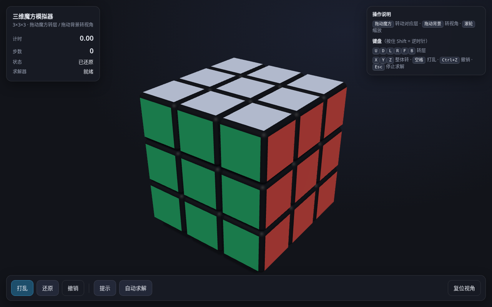

# 三维魔方模拟器

浏览器中的 3×3×3 魔方：Three.js 渲染，支持手动转层、打乱、撤销、计时、整体旋转，以及基于 cubejs 的自动求解与提示。



## 运行

需要 Node.js。测试依赖要求 Node.js 20 或更新版本。

```bash
git clone https://github.com/yykina/rubik-3d-simulator.git
cd rubik-3d-simulator
npm run serve
```

打开 <http://127.0.0.1:5173/>。运行页面无需安装 npm 依赖；Three.js 从 jsDelivr CDN 加载，需要联网及支持 WebGL 的现代浏览器。

## 操作

| 操作 | 方式 |
| --- | --- |
| 转动某一层 | 拖动魔方，或按 `U D L R F B` |
| 反向转动 | 按住 `Shift` 再按对应面键 |
| 旋转视角 / 缩放 | 拖动背景 / 滚轮 |
| 整体旋转 | `X Y Z`，配合 `Shift` 可反向 |
| 打乱 / 撤销 | 空格 / `Ctrl+Z` 或 `Cmd+Z` |
| 自动求解 / 提示 | 点击对应按钮，初始化完成后可用 |
| 停止自动播放 | `Esc` 或「停止」按钮 |

打乱动作不计成绩，打乱结束后开始计时。提示展示完整解法；自动求解会逐步播放。

## 验证与开发

```bash
npm ci
npx playwright install chromium
npm test
npm run verify:solver
npm run verify
```

Linux 环境若缺少浏览器系统库，可使用 `npx playwright install --with-deps chromium`。
浏览器验证截图写入 `test-results/shots/`，不会进入 Git。

- `src/cube-core.js`：几何、状态操作、还原判定及官方面片编码；修改后同步至 `web/cube-core.js`。
- `web/index.html`：三维渲染、交互与求解器接入。
- `vendor/cubejs/`：cubejs 1.3.2 源码；浏览器包用 `npm run build:cubejs` 生成。
- `tools/`：静态服务器、打包与验证脚本。
- [STATUS.md](STATUS.md)：当前状态、约定与限制。
- [src/SOLVER-NOTES.md](src/SOLVER-NOTES.md)：求解器实验及最终接入方案。
- [CHANGLOG.md](CHANGLOG.md)：变更记录。
- [CODE_REVIEW.md](CODE_REVIEW.md)：历史审查与本次复核记录。

求解通过 `Core.faceletString()` 接入 cubejs。旧的 `Core.Solver` 和 `vendor/min2phase.port.js` 保留作实验记录，当前页面不调用它们。

## 已知限制与第三方代码

求解器初始化采用同步建表，通常约 1–2 秒，期间主线程可能短暂阻塞；当前没有 Web Worker。
触屏双指交互尚未完善，验证以桌面 Chromium 为主。

cubejs 使用 MIT 许可证，完整声明见 [vendor/cubejs/LICENSE](vendor/cubejs/LICENSE)，浏览器包也保留声明。
历史 min2phase 移植代码的声明见 [vendor/min2phase.LICENSE](vendor/min2phase.LICENSE)。
Three.js 从 CDN 加载，来源为 [mrdoob/three.js](https://github.com/mrdoob/three.js)。
